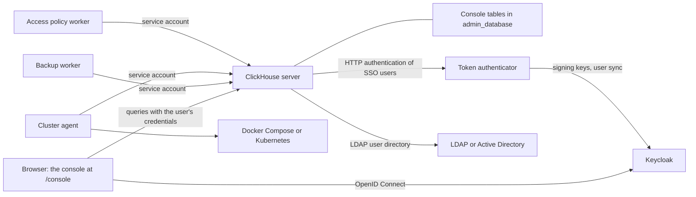

The ClickHouse Web Console is a single entry point to a ClickHouse server in a browser. It is served by the server itself
at `/console`, for example `http://localhost:8123/console`, and needs no separate web server or database. You sign in
once, as a ClickHouse user, and work in one window: the SQL Console, dashboards, and diagnostics, and the administration
of users, roles, data access, backups, clusters, and identity providers.

The console is a user interface, not a security boundary. Every query and every administrative action runs with the
credentials of the signed-in user, and the ClickHouse server authorizes each one with its own access control. What the
console hides or shows never changes what a user can do.

## Components {#components}

| Component | What it does | Runs where |
|---|---|---|
| Console | Sign-in, home page, sidebar, and the panels: SQL Console, Dashboard, ClickStack, Web Terminal, Binary, Merges and Schema visualizers, Jemalloc, Processors profile, Reference. | The browser; served by the server at `/console`. |
| Administration | Users, Roles & Permissions, Data Access Policies, Component Access, Profiles & Quotas, Audit Activity, Clusters, Backup & Restore. | The browser. Changes are SQL statements run as the signed-in user; the console's own state is kept in tables of the `admin_database`. |
| Identity Providers | The LDAP page (LDAP and Active Directory user directories) and the SSO (Keycloak) page (OpenID Connect). | The browser, and the server configuration. |
| Backup worker | Runs backup schedules and retention, deletions, and server bundles (configuration, secrets, and Keeper data, encrypted). | A Node.js process or the tools image. |
| Cluster agent | Creates and operates clusters through Docker Compose or Kubernetes. | A Node.js process or the tools image. |
| Access policy worker | Keeps grants and row policies in line with the policy rules, and imports user attributes. | A Node.js process or the tools image. |
| Token authenticator | Checks the single sign-on tokens of users for the server, and syncs users and roles from Keycloak groups. | A Node.js process or the tools image. |

The helper processes are optional. Each one is needed only for the features it serves, and each one connects to the
server with a service account of its own.

## Architecture {#architecture}

- **The browser talks only to ClickHouse** (and to Keycloak when single sign-on is used). The console keeps the
  credentials in the memory of the tab, and sends them with each request.
- **Requests are the queue.** The console records requests for long-running work, such as a backup schedule or a
  cluster operation, in console tables. The helper processes pick them up, do the work with their own service account,
  check the requester's privileges where it matters, and record the results. The console shows those results.
- **The server is the authority.** Users, roles, grants, row policies, and settings profiles are native ClickHouse
  entities. The console creates them with `CREATE USER`, `GRANT`, `CREATE ROW POLICY`, and the like, so they work the
  same for every client.

## Where to start {#where-to-start}

- **New to the console?** Follow the [Quick start](/products/web-console/quick-start), then the tutorial
  [Set up the console as its first administrator](/products/web-console/tutorials/first-administrator).
- **Learning a feature?** The tutorials walk through
  [data access policies](/products/web-console/tutorials/data-access-policies),
  [backups](/products/web-console/tutorials/backups), and
  [single sign-on with Keycloak](/products/web-console/tutorials/single-sign-on).
- **Using a page?** The user guides explain each area: [the console](/products/web-console/guides/console),
  [users and roles](/products/web-console/guides/users-and-roles),
  [component access](/products/web-console/guides/component-access),
  [data access policies](/products/web-console/guides/data-access-policies),
  [profiles and quotas](/products/web-console/guides/profiles-and-quotas),
  [audit activity](/products/web-console/guides/audit-activity),
  [backup and restore](/products/web-console/guides/backup-and-restore),
  [clusters](/products/web-console/guides/clusters), and
  [identity providers](/products/web-console/guides/identity-providers).
- **Doing a task?** The how-to guides cover deployment with
  [Docker Compose](/products/web-console/how-to/deploy-with-docker-compose) or
  [Kubernetes](/products/web-console/how-to/deploy-on-kubernetes),
  [service accounts](/products/web-console/how-to/create-service-accounts),
  [LDAP and Active Directory](/products/web-console/how-to/configure-ldap),
  [Keycloak single sign-on](/products/web-console/how-to/configure-keycloak-sso),
  [user attributes](/products/web-console/how-to/import-user-attributes),
  [offboarding](/products/web-console/how-to/offboard-a-user),
  [recovering access](/products/web-console/how-to/recover-access-to-the-console),
  [protecting backups](/products/web-console/how-to/protect-backups), and
  [recovering a server](/products/web-console/how-to/recover-a-server).
- **Integrating or operating it?** The reference lists the [configuration](/products/web-console/reference/configuration),
  the [HTTP endpoints](/products/web-console/reference/http-endpoints), the
  [console tables](/products/web-console/reference/console-tables), the
  [privileges](/products/web-console/reference/privileges), the
  [helper processes](/products/web-console/reference/helper-processes), and the
  [token authenticator API](/products/web-console/reference/token-authenticator-api).

## Requirements {#requirements}

- A ClickHouse server built with the web console. It serves the console on every HTTP port, at `/console`.
- A recent desktop browser: Chrome, Edge, Firefox, or Safari. The console runs on the device of the user.
- For the helper processes: Node.js 18 or later, or the tools image `clickhouse-console-tools`.
- For single sign-on: an OpenID Connect provider (Keycloak 26 is tested) and the token authenticator.

The console needs no Internet access. The Binary visualizer and Jemalloc panels load libraries from public CDNs and do
not work offline.
